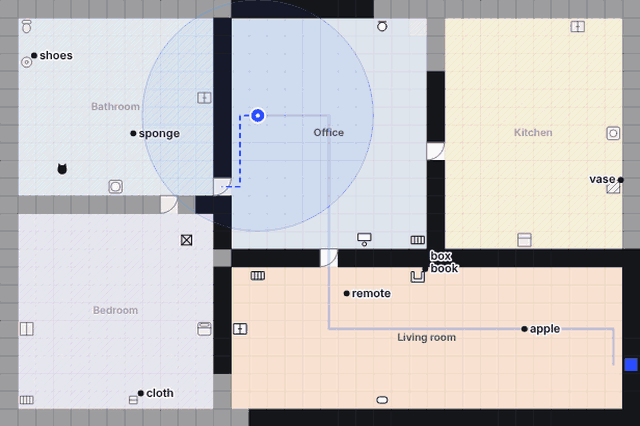

# What helps a robot find things?

[](https://github.com/groxburgh/robot-in-a-strange-house/actions/workflows/ci.yml)

A small study, with a demo, of memory and common sense in a simulated home that keeps changing.

A robot arrives at a house it has never seen. You ask it for things in plain English. Meanwhile the people who live there keep moving things around, closing doors and leaving clutter, and the cat gets in the way. This project tests what the robot should do when the world no longer matches its memory.

**[Try the demo in your browser](https://groxburgh.github.io/robot-in-a-strange-house/)**. No install, no account.



## Main finding

**A robot that re-checks finds things far more reliably than one that trusts its memory.** 
In each episode the robot explores a new house, then waits 300 steps while the household carries on, then is asked to bring one object. Nothing ever leaves the house, so "it isn't here" is always the wrong answer. 200 houses per row ([`bench/dynamic.js`](bench/dynamic.js)).

| House | Memory | Success | Wrongly said "not here" | Memory wrong when asked | Mean steps (successes) |
|---|---|---|---|---|---|
| Nobody home | Trusts memory | 90.5% | 9.5% | 9.5% | 62 |
| Nobody home | **Re-checks** | **100.0%** | **0.0%** | 9.5% | 73 |
| Lived-in | Trusts memory | 54.5% | 45.5% | 62.0% | 63 |
| Lived-in | **Re-checks** | **98.0%** | **2.0%** | 62.0% | 113 |
| Chaotic | Trusts memory | 41.5% | 58.5% | 83.5% | 86 |
| Chaotic | **Re-checks** | **95.5%** | **4.5%** | 83.5% | 139 |
| Nobody home, poor eyesight | Trusts memory | 74.0% | 26.0% | 26.0% | 58 |
| Nobody home, poor eyesight | **Re-checks** | **100.0%** | **0.0%** | 26.0% | 101 |

- **Trusting memory breaks as soon as other people live in the house.** In a lived-in house the robot's memory was out of date in 62% of episodes, and the robot that trusted it wrongly reported the object missing 45.5% of the time.
- **Re-checking is reliable but costs walking.** The re-checking robot succeeded in 98% of lived-in episodes. Its successful runs averaged 113 steps against 63, because it searches rooms again before giving up.
- **Even an empty house has the problem.** Small things (cutlery, a sponge, a cloth, the remote) are only noticed up close. A robot that walked past one at a distance never goes back, which looks exactly like the thing having moved. Poor eyesight makes this worse.
- **Re-checking still fails sometimes.** In a chaotic house, things occasionally get moved into a room the robot has just re-checked.

"Re-checks" means the robot timestamps every sighting. When something isn't where it remembers and nothing new is left to explore, it goes back over every place it hasn't looked at closely enough since you asked.

## Also tested

**Room hints made no measurable difference where people actually leave things.** The robot can bias its search toward rooms where the object is likely to be. The benchmark compares no hints, common-sense hints from one public dataset (ProcTHOR) and hints from the same human data that decided where things were left (Housekeep). Each robot ran the same 300 houses and errands, and the change is shown with a 95% bootstrap interval ([`bench/run.js`](bench/run.js)).

| Where things were left | Robot's room hints | Mean steps | Change vs no hints (95% CI) | SPL |
|---|---|---|---|---|
| Where people leave things (Housekeep) | None | 134 | n/a | 0.605 |
| Where people leave things (Housekeep) | Common sense (ProcTHOR) | 131 | -3.1 (-10.2 to 3.9) | 0.621 |
| Where people leave things (Housekeep) | Human data (Housekeep) | 130 | -3.9 (-11.6 to 3.8) | 0.614 |
| In the rooms they belong (ProcTHOR) | None | 135 | n/a | 0.647 |
| In the rooms they belong (ProcTHOR) | Common sense (ProcTHOR) | 125 | **-10.0 (-15.9 to -4.6)** | 0.679 |
| In the rooms they belong (ProcTHOR) | Human data (Housekeep) | 139 | +4.0 (-2.4 to 10.1) | 0.609 |
| Anywhere (random) | None | 134 | n/a | 0.641 |
| Anywhere (random) | Common sense (ProcTHOR) | 137 | +3.2 (-2.8 to 9.1) | 0.615 |
| Anywhere (random) | Human data (Housekeep) | 138 | +4.4 (-2.4 to 11.1) | 0.581 |

The only clear effect is common-sense hints in a house that follows common sense. In Housekeep's annotations, misplaced things are spread almost evenly across rooms, so knowing where a mug *belongs* says little about where it was *left*. SPL is Success weighted by Path Length (Peter Anderson et al., "On Evaluation of Embodied Navigation Agents", July 2018). It divides the shortest route with a known floor plan by the route taken, so 1.0 would mean exploring cost nothing.

**Housekeep's answers needed care.** Housekeep's annotators were shown an object in one room at a time and asked which surfaces in that room would be right or wrong for it. Used naively, their answers put a plate in the bedroom wardrobe and shoes in the bathroom cabinet. For "tidy up", the robot therefore only uses surfaces a majority of annotators approved, in the room types ProcTHOR rates highest for that object. With that rule, tidy-up put everything away in all 100 test houses, at about 900 steps each.

## How it works

| Part | What it does | Where |
|---|---|---|
| House generator | Splits a floor plate into 5 to 7 rooms, one doorway per split so every room is reachable, furniture against the walls, 6 to 8 objects left where Housekeep's annotators said such things end up | [`src/house.js`](src/house.js) |
| Household | Moves objects, closes and sometimes locks doors, leaves clutter, walks the cat around. It only changes what the robot can't currently see, and never cuts off part of the house | [`src/household.js`](src/household.js) |
| Perception | Line-of-sight raycasting. Walls and closed doors block sight. Larger objects are noticed from 6 cells away, small ones from 3 | [`src/robot.js`](src/robot.js) |
| Memory | Occupancy grid plus a semantic map (rooms, furniture, objects), every sighting timestamped | [`src/robot.js`](src/robot.js) |
| Planning | Breadth-first search over cells it has actually seen, re-planned every step. Opens doors, routes around clutter, waits for the cat | [`src/robot.js`](src/robot.js) |
| Search | Explores the edge of the unknown first, then (with re-checking on) every place not looked at closely since the request | [`src/robot.js`](src/robot.js) |
| Language | Rule-based parser for commands like "put the mug in the cupboard, then bring me the remote". Deterministic and offline | [`src/parser.js`](src/parser.js) |
| Data | Object placements and room hints built from the two public datasets below | [`tools/build_priors.py`](tools/build_priors.py) |

Plain JavaScript, no dependencies, no build step. The same code runs in the browser and in Node.

## Data sources

- **Housekeep**: Yash Kant et al., "Housekeep: Tidying Virtual Households using Commonsense Reasoning", ECCV 2022. Human annotations of where 268 kinds of object are found when misplaced and where they belong. MIT licence ([`third_party/housekeep-LICENSE.txt`](third_party/housekeep-LICENSE.txt)).
- **ProcTHOR**: Matt Deitke et al., "ProcTHOR: Large-Scale Embodied AI Using Procedural Generation", NeurIPS 2022 (Allen Institute for AI). A 0-2 score for how likely each object type is in kitchens, living rooms, bedrooms and bathrooms. Apache 2.0 licence ([`third_party/procthor-LICENSE.txt`](third_party/procthor-LICENSE.txt)).

`src/data.js` contains processed counts derived from both. It's regenerated with `tools/hk_extract.py` and `tools/build_priors.py`.

## Background

The premise comes from Figure AI CEO Brett Adcock's interview on *Moonshots with Peter Diamandis* (16 November 2026), as reported by Humanoids Daily (Pontus Armini, 17 November 2026). Adcock's bar is that a home robot isn't ready until it can walk into an unfamiliar house and follow spoken instructions without help. In research this is called open-vocabulary mobile manipulation. In the NeurIPS 2023 HomeRobot challenge, the best team's success rate on the hardest simulated version was 10.8% (Sriram Yenamandra et al., "Towards Open-World Mobile Manipulation in Homes: Lessons from the NeurIPS 2023 HomeRobot Open Vocabulary Mobile Manipulation Challenge", July 2024).

## Limitations

- It's a grid world. Picking things up always works and takes one step, and real manipulation is most of the difficulty.
- The household moves things at random times. Real households have habits a robot could learn.
- Perception is all-or-nothing within a fixed range. Real detectors also see things that aren't there.
- Housekeep has 10 annotators per object and surface, and several of its surface types are merged into each piece of furniture here.
- The parser is rule-based. A language model could replace it without changing anything else, since its only job is to produce a task list.

## How this was built

Greg Roxburgh chose the problem, set the goals and audience, and made the calls on scope at each stage: the changing household, the switch to public data, and the framing as a study. Claude (Anthropic) researched the datasets and prior work and wrote the code, tests and benchmarks.

## Run it locally

Requires Node 18 or later. No `npm install` needed.

```bash
git clone https://github.com/groxburgh/robot-in-a-strange-house.git
cd robot-in-a-strange-house
npm test                # generator, parser, robot and household tests
npm run bench:dynamic   # memory benchmark (about a minute)
npm run bench           # room-hint benchmark (about a minute)
npm run serve           # then open http://localhost:8000
```

URL options: `#house-42` picks a house. `?demo=tidy%20up&speed=60&activity=3&reveal=1` runs a command on load.

## License

MIT, except the third-party data noted above.
